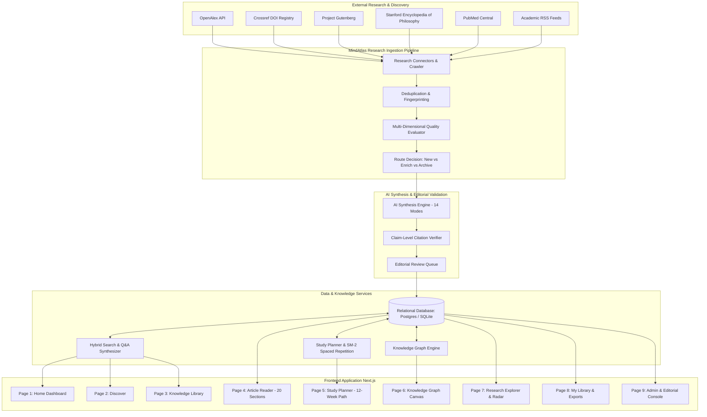

# MindAtlas System Architecture

**MindAtlas: The Ever-Growing Human Knowledge Library** is an evidence-grounded, production-ready knowledge and learning platform dedicated to collecting, evaluating, organizing, connecting, and teaching the world's best educational material on psychology, philosophy, cognitive science, neuroscience, behavioral economics, and critical thinking.

---

## 1. High-Level System Architecture

---

## 2. Core Subsystems

### A. Global Research and Source Discovery Engine
- **Source Registry**: Maintains canonical URLs, open-access licensing classifications (`CC-BY`, `CC0`, `Public Domain`), publisher credentials, rate limits, and reliability scores.
- **Polite Crawling Protocol**: Respects `robots.txt`, implements exponential backoff, request throttling (1.0s delay), and transparent user-agent identification (`MindAtlas-ResearchCrawler/1.0`).
- **Official Open-Access Endpoints**: Prioritizes structured APIs (OpenAlex, Crossref, arXiv, Gutenberg) before HTML content extraction. Never bypasses paywalls or access controls.

### B. Daily Automated Research Pipeline (15 Steps)
1. **Discover**: Identify newly published or updated works across configured academic sources.
2. **Retrieve**: Fetch permitted bibliographic metadata and accessible abstracts.
3. **Extract**: Parse authors, canonical URLs, publication dates, DOIs, and licensing status.
4. **Normalize**: Map disparate external schemas into the MindAtlas common schema.
5. **Deduplicate**: Prevent redundant entries via DOI matching, canonical URL normalization, and SHA-256 content fingerprinting.
6. **Classify**: Assign discipline, subtopics, intended audience, and format.
7. **Evaluate Quality**: Compute multi-dimensional score across authority, evidence rigor, relevance, originality, and citation traceability.
8. **Extract Claims**: Identify discrete assertions, empirical findings, and methodological caveats.
9. **Connect Graph**: Link entities to existing knowledge graph nodes (concepts, theories, thinkers).
10. **Route Decision**: Determine whether to generate a new article, enrich an existing monograph, or retain as a library reference.
11. **Synthesize Draft**: Produce a comprehensive educational article across 14 distinct modes.
12. **Automated Checks**: Run factual consistency, citation integrity, and plagiarism-prevention verification.
13. **Editorial Gateway**: Publish automatically if score $\ge 0.85$ and citations pass; otherwise route to human review queue.
14. **Index Update**: Rebuild graph adjacencies, search indexes, and active study plans.
15. **Audit Logging**: Persist immutable records of every step in `audit_logs` and `processing_jobs`.

### C. Multi-Dimensional Scoring Framework
Rather than relying on vanity metrics or citation counts:
$$\text{Quality Score} = 0.20(\text{Auth}) + 0.25(\text{Rigor}) + 0.20(\text{Relevance}) + 0.15(\text{Orig}) + 0.10(\text{Trace}) + 0.10(\text{License})$$

- **Psychology**: Differentiates meta-analyses and preregistered trials from uncontrolled observational studies.
- **Philosophy**: Assesses argument structure, premise validity, and counterargument engagement.
- **Critical Thinking**: Differentiates formal structural invalidity from informal fallacies and mere unpersuasive rhetoric.
- **Neuroscience**: Distinguishes direct human neuroimaging from animal model extrapolation.

### D. 20-Section Educational Synthesis
Every published article implements:
1. Clear Title & Short Summary
2. Why the Subject Matters
3. Learning Objectives
4. Prerequisite Concepts
5. Beginner-Friendly Explanation
6. Detailed Explanation for Advanced Readers
7. Historical & Intellectual Lineage
8. Major Thinkers & Paradigm Contributions
9. Concrete Everyday Examples
10. Case Studies & Classic Experiments
11. Common Misconceptions & Distinctions
12. Counterarguments & Ecological Objections
13. Practical Applications
14. Limitations & Unresolved Questions
15. Knowledge Graph Connections
16. Key Takeaways Callout
17. Review Questions & Exercises
18. Interactive Flashcards (Active Recall)
19. Further Reading Ranked by Difficulty
20. Complete Verified References (with DOI links, authors, and passage references)

### E. Personalized Study Planner & Spaced Repetition (SM-2)
- Structured 12-week interdisciplinary path spanning Epistemology, Deductive/Inductive Logic, Fallacies, Biases, Research Literacy, Psychology of Belief, Decision Science, Normative Ethics, Existentialism, and Social Dynamics.
- SuperMemo SM-2 interval calculation:
$$EF' = EF + (0.1 - (5 - q) \cdot (0.08 + (5 - q) \cdot 0.02))$$
Where $q \in [0, 5]$ is user active recall rating, updating ease factors and next review timestamps.
