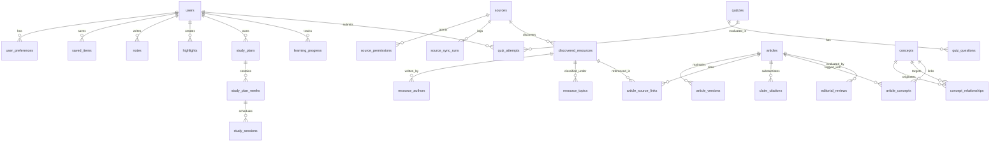

# MindAtlas Relational Data Model

MindAtlas maintains complete provenance, version history, claim-level citations, and graph relationships in a normalized relational schema.

---

## Entity Relationship Overview

---

## Table Definitions

### 1. Identity & Personalization
- `users`: ID, username, email, hashed_password, role (`reader`, `editor`, `admin`), is_active, created_at.
- `user_preferences`: ID, user_id (FK), theme, font_family, font_size, daily_time_budget_mins, preferred_depth, topics_of_interest (JSON), digest_frequency.

### 2. Sources & Provenance
- `sources`: ID, name, canonical_url, category, subject_coverage (JSON), publisher_institution, ingestion_method (`api`, `rss`, `open_access`), access_licensing, rate_limit_per_minute, reliability_score, authority_score, operational_status, last_successful_sync.
- `source_permissions`: ID, source_id (FK), allows_abstract_ingestion, allows_fulltext_indexing, attribution_requirements, license_url.
- `source_sync_runs`: ID, source_id (FK), started_at, completed_at, status (`running`, `success`, `failed`), items_discovered, items_ingested, error_message, execution_log (JSON).

### 3. Discovered Resources & Scoring
- `discovered_resources`: ID, source_id (FK), external_id, doi, canonical_url, title, abstract, content_fingerprint (SHA-256), published_date, primary_discipline, subtopics (JSON), format_type, methodology_type, overall_quality_score, authority_score, evidence_rigor_score, relevance_score, originality_score, traceability_score, quality_justification, is_processed, created_at.
- `resource_authors`: ID, resource_id (FK), author_name, affiliation, orcid.
- `resource_topics`: ID, resource_id (FK), topic_name, relevance_weight.

### 4. Educational Articles & Claim Citations
- `articles`: ID, slug (unique index), title, subtitle, summary, article_type, primary_discipline, subdisciplines (JSON), reading_time_mins, difficulty_level, why_it_matters, learning_objectives (JSON), prerequisite_concepts (JSON), beginner_explanation, detailed_explanation, historical_background, major_theories_and_thinkers (JSON), concrete_examples (JSON), case_studies_and_experiments (JSON), common_misconceptions (JSON), counterarguments_and_alternatives (JSON), practical_applications (JSON), limitations_and_unresolved_questions (JSON), key_takeaways (JSON), review_questions (JSON), flashcards (JSON), further_reading (JSON), status (`draft`, `pending_review`, `published`, `archived`), current_version, published_at, last_reviewed_at.
- `article_versions`: ID, article_id (FK), version_number, change_summary, full_content_snapshot (JSON), created_by, created_at.
- `article_source_links`: ID, article_id (FK), resource_id (FK), citation_type (`primary_evidence`, `theoretical_foundation`, `counter_argument`).
- `claim_citations`: ID, article_id (FK), passage_reference, claim_text, supporting_quote_or_finding, source_title, source_author, source_year, doi, canonical_url, page_or_section, verification_status (`verified`, `unverified`, `contested`), confidence_score.

### 5. Knowledge Graph
- `concepts`: ID, slug (unique index), name, category (`concept`, `theory`, `thinker`, `experiment`, `fallacy`, `bias`), discipline, short_definition, detailed_overview, importance_rank.
- `concept_relationships`: ID, source_concept_id (FK), target_concept_id (FK), relationship_type (`prerequisite_of`, `related_to`, `contradicts`, `supports`, `extends`, `critiques`, `influenced_by`, `applies_to`), rationale, evidence_citation.
- `article_concepts`: ID, article_id (FK), concept_id (FK), is_primary.

### 6. Personal Library & Notes
- `collections`: ID, user_id (FK), title, description, is_private, created_at.
- `saved_items`: ID, user_id (FK), collection_id (FK nullable), item_type (`article`, `resource`, `concept`), target_id, status (`saved`, `reading`, `completed`), reading_progress_percent, created_at.
- `notes`: ID, user_id (FK), article_id (FK nullable), concept_id (FK nullable), title, content_markdown, tags (JSON), created_at, updated_at.
- `highlights`: ID, user_id (FK), article_id (FK), passage_text, annotation, color, created_at.

### 7. Study Planner & Spaced Repetition
- `study_plans`: ID, user_id (FK), title, description, discipline_or_goal, total_weeks, daily_time_minutes, current_week, status, created_at.
- `study_plan_weeks`: ID, study_plan_id (FK), week_number, title, theme_objective, prerequisites_met.
- `study_sessions`: ID, week_id (FK), day_number, session_title, objective, estimated_duration_mins, core_concepts (JSON), article_slug, guided_questions (JSON), practical_exercises (JSON), reflection_prompt, flashcards (JSON), completion_checklist (JSON), suggested_review_date, is_completed, comprehension_rating.
- `quizzes`: ID, title, topic, difficulty.
- `quiz_questions`: ID, quiz_id (FK), question_text, options (JSON), correct_option_index, explanation, concept_reference.
- `quiz_attempts`: ID, user_id (FK), quiz_id (FK), score_percentage, answers_submitted (JSON), attempted_at.
- `review_schedule`: ID, user_id (FK), item_type, target_id, interval_days, repetition_count, scheduled_for.

### 8. Administration & Audit
- `editorial_reviews`: ID, article_id (FK), reviewer_name, status, review_notes, citation_fidelity_score, reviewed_at.
- `processing_jobs`: ID, job_type, status (`pending`, `running`, `completed`, `failed`), started_at, completed_at, items_processed, error_message, job_metadata (JSON).
- `audit_logs`: ID, actor, action_type, target_entity, target_id, details (JSON), timestamp.
